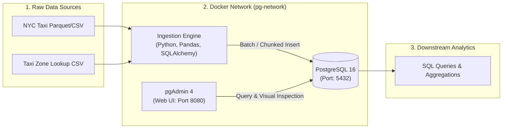

# NYC Taxi Data Ingestion & Analytics Pipeline

An end-to-end containerized batch data ingestion and relational analytics pipeline built with **Docker**, **PostgreSQL**, **pgAdmin**, and **Python**.

This project is part of the **Data Engineering Zoomcamp (Module 1)** curriculum, focusing on reproducible infrastructure, containerized relational databases, and memory-safe data ingestion workflows.

---

## Architecture Overview



---

## Tech Stack

| Component | Technology | Purpose |
| :--- | :--- | :--- |
| **Containerization** | Docker, Docker Compose | Service isolation, networking, and reproducible environments |
| **Database** | PostgreSQL 16 | Relational OLTP database for structured taxi trip records |
| **Database UI** | pgAdmin 4 | Web interface for database inspection and query execution |
| **Ingestion Engine** | Python 3.13 / `uv` | Chunked batch ingestion using Pandas and SQLAlchemy |
| **Shell & Scripting** | GNU Bash (Git Bash) | Environment automation, service control, and CLI tooling |

---

## Repository Structure

```
postgres_docker/
├── .gitignore               # Protects against committing large datasets and secrets
├── pyproject.toml           # Project dependencies managed via uv
├── README.md                # Project architecture and execution documentation
├── docker-compose.yaml      # Multi-container orchestration (Postgres 16 + pgAdmin 4)
├── ingest.py                # Parameterized chunked CLI ingestion engine (Parquet + CSV)
└── Dockerfile               # Container definition for the ingestion pipeline [Upcoming]
```

---

## Getting Started

### 1. Prerequisites
Ensure you have the following installed on your machine:
* **Docker Desktop** (running)
* **Git Bash** (recommended terminal on Windows)
* **Python 3.13+** or **uv**

### 2. Environment Setup (Git Bash)
Clone the repository and enter the working directory:
```bash
git clone https://github.com/YaadiY/postgres_docker.git
cd postgres_docker
```

### 3. Start Database & UI Infrastructure
Launch the PostgreSQL and pgAdmin containers in detached mode:
```bash
docker compose up -d
```
* **PostgreSQL:** Accessible on `localhost:5432` (User: `root`, DB: `ny_taxi`)
* **pgAdmin 4:** Accessible on [http://localhost:8080](http://localhost:8080) (Login: `root@root.com`, Password: `root`)
* *Internal Docker Hostname:* `pgdatabase` on network `pg-network`

To stop services:
```bash
docker compose down
```

### 4. Download NYC Taxi Datasets
Use the multi-threaded downloader script to fetch Parquet datasets directly into `nyc_taxi_data/`:
```bash
# Download a single year of Yellow Taxi data (e.g. 2024)
uv run python download_data.py --types yellow --start-year 2024 --end-year 2024

# Download full archive across all services (Yellow, Green, FHV, High-Volume FHV) from 2009 to present
uv run python download_data.py --types all --start-year 2009 --end-year 2026 --workers 6

# Preview downloads without downloading (Dry Run)
uv run python download_data.py --types yellow green --start-year 2024 --end-year 2024 --dry-run
```

### 5. Run Chunked Data Ingestion
Stream dataset files directly into PostgreSQL using the CLI engine:
```bash
# Ingest Taxi Zone Lookup (CSV)
uv run python ingest.py --table_name zones --url taxi_zone_lookup.csv

# Ingest Yellow Taxi Trips (Parquet, ~3.72M records)
uv run python ingest.py --table_name yellow_taxi_trips --url nyc_taxi_data/yellow_tripdata_2024-01.parquet

# Ingest one month by year and month (replaces the target table on the first file)
uv run python ingest.py --year 2025 --month 1 --taxi_type yellow --table_name yellow_taxi_trips_2025_01 --if_exists replace
```

### 6. Build a Clean Analytics Table
Run [`sql/clean_yellow_taxi_2025.sql`](sql/clean_yellow_taxi_2025.sql) in pgAdmin's Query Tool after loading `yellow_taxi_trips_2025_01`. It preserves the ingested table and rebuilds `yellow_taxi_trips_2025_01_clean`, filtering out-of-month pickups, invalid time order, and negative or missing trip distances. The clean table also includes pickup date, trip duration, and pickup/dropoff zone names. See the [data quality workflow](docs/data_quality_workflow.md) for the current database snapshot, validation approach, and next steps.

### 7. Profile the Clean Data
Run [`sql/profile_yellow_taxi_2025_01.sql`](sql/profile_yellow_taxi_2025_01.sql) in pgAdmin to review nulls, unusual values, percentiles, and sample outliers. The profile is read-only; it helps distinguish records to flag for review from records that should be excluded by a documented rule.

Run [`sql/flag_yellow_taxi_2025_01.sql`](sql/flag_yellow_taxi_2025_01.sql) to create a review view with provisional anomaly flags. It preserves every flagged trip and does not delete data.

Run [`sql/explore_distribution_yellow_taxi_2025_01.sql`](sql/explore_distribution_yellow_taxi_2025_01.sql) to compare averages, medians, percentiles, IQR fences, and distance buckets when investigating outliers.

Current quality review: negative fares among January Flex Fare trips (`payment_type = 0`) are concentrated in Vendor 2, and negative totals in that group are especially concentrated on January 1. This is documented as an unresolved source-data pattern; flagged rows remain in the dataset while the payment and fare reporting semantics are investigated. See the [data quality workflow](docs/data_quality_workflow.md) for counts, hourly patterns, and the component-sum check.

---

### Study Notes and Interview Preparation

Use the [study-notes index](docs/study_notes/README.md) for separate notes on this pipeline's Bronze/Silver/Gold layers, SQL, PostgreSQL, Docker, Python ingestion, Bash, Kafka, data modeling, orchestration, lakehouse concepts, governance, and interview practice. The notes distinguish what this repository implements today from topics that are still study goals.

### Gold Reporting View

The [Gold SQL model](sql/gold_yellow_taxi_daily_demand_2025_01.sql) creates the daily demand view at one row per pickup date, pickup borough/zone, dropoff borough/zone, and payment type. It includes trip totals and review counts. Validation against the January Silver table confirmed all 3,475,080 source rows are represented across 463,623 Gold groups; the review-flag, negative-fare, and negative-total counts also match the Silver and flagged views. Revenue measures are omitted until negative-fare and Flex Fare behavior has a documented business treatment. See the [data-quality workflow](docs/data_quality_workflow.md) for the checks and their limits.

Use [`sql/analyze_gold_yellow_taxi_2025_01.sql`](sql/analyze_gold_yellow_taxi_2025_01.sql) for read-only exploration of daily totals, weekday averages, and weekday demand by pickup borough.

To visualize the daily totals, follow the [first Power BI chart walkthrough](docs/dashboard_first_chart.md).

## Roadmap & Progress Tracker

- [x] Repository initialization & Git configuration
- [x] Git ignore rules for large dataset files (`.parquet`, `.csv`)
- [x] Docker Compose setup for PostgreSQL 16 & pgAdmin 4
- [x] Chunked data ingestion script (`ingest.py`)
- [x] Multi-threaded dataset downloader with resuming & validation (`download_data.py`)
- [x] January Silver quality review and reconciled Gold daily-demand view
- [ ] Multi-month full dataset batch ingestion automation
- [ ] Dockerizing the ingestion pipeline (`Dockerfile`)
- [ ] Analytical SQL queries & homework validation
