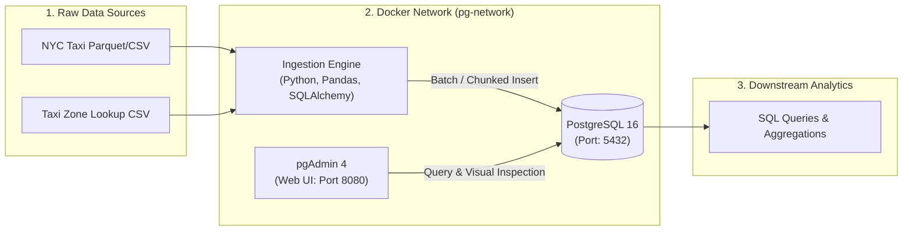

# NYC Taxi Data Ingestion & Analytics Pipeline

An end-to-end containerized batch data ingestion and relational analytics pipeline built with **Docker**, **PostgreSQL**, **pgAdmin**, and **Python**.

This project is part of the **Data Engineering Zoomcamp (Module 1)** curriculum, focusing on reproducible infrastructure, containerized relational databases, and memory-safe data ingestion workflows.

---

## Architecture Overview



---

## Tech Stack

| Component | Technology | Purpose |
| :--- | :--- | :--- |
| **Containerization** | Docker, Docker Compose | Service isolation, networking, and reproducible environments |
| **Database** | PostgreSQL 16 | Relational OLTP database for structured taxi trip records |
| **Database UI** | pgAdmin 4 | Web interface for database inspection and query execution |
| **Ingestion Engine** | Python 3.13 / `uv` | Chunked batch ingestion using Pandas and SQLAlchemy |
| **Shell & Scripting** | GNU Bash (Git Bash) | Environment automation, service control, and CLI tooling |

---

## Repository Structure

```
postgres_docker/
├── .gitignore               # Protects against committing large datasets and secrets
├── pyproject.toml           # Project dependencies managed via uv
├── README.md                # Project architecture and execution documentation
├── docker-compose.yaml      # Multi-container orchestration (Postgres 16 + pgAdmin 4)
├── ingest.py                # Parameterized chunked CLI ingestion engine (Parquet + CSV)
└── Dockerfile               # Container definition for the ingestion pipeline [Upcoming]
```

---

## Getting Started

### 1. Prerequisites
Ensure you have the following installed on your machine:
* **Docker Desktop** (running)
* **Git Bash** (recommended terminal on Windows)
* **Python 3.13+** or **uv**

### 2. Environment Setup (Git Bash)
Clone the repository and enter the working directory:
```bash
git clone https://github.com/YaadiY/postgres_docker.git
cd postgres_docker
```

### 3. Start Database & UI Infrastructure
Launch the PostgreSQL and pgAdmin containers in detached mode:
```bash
docker compose up -d
```
* **PostgreSQL:** Accessible on `localhost:5432` (User: `root`, DB: `ny_taxi`)
* **pgAdmin 4:** Accessible on [http://localhost:8080](http://localhost:8080) (Login: `root@root.com`, Password: `root`)
* *Internal Docker Hostname:* `pgdatabase` on network `pg-network`

To stop services:
```bash
docker compose down
```

### 4. Run Chunked Data Ingestion
Stream dataset files directly into PostgreSQL using the CLI engine:
```bash
# Ingest Taxi Zone Lookup (CSV)
uv run python ingest.py --table_name zones --url taxi_zone_lookup.csv

# Ingest Yellow Taxi Trips (Parquet, ~3.72M records)
uv run python ingest.py --table_name yellow_taxi_trips --url yellow_tripdata_2026-01.parquet
```

---

## Roadmap & Progress Tracker

- [x] Repository initialization & Git configuration
- [x] Git ignore rules for large dataset files (`.parquet`, `.csv`)
- [x] Docker Compose setup for PostgreSQL 16 & pgAdmin 4
- [x] Chunked data ingestion script (`ingest.py`)
- [ ] Multi-month full dataset ingestion & automation
- [ ] Dockerizing the ingestion pipeline (`Dockerfile`)
- [ ] Analytical SQL queries & homework validation
