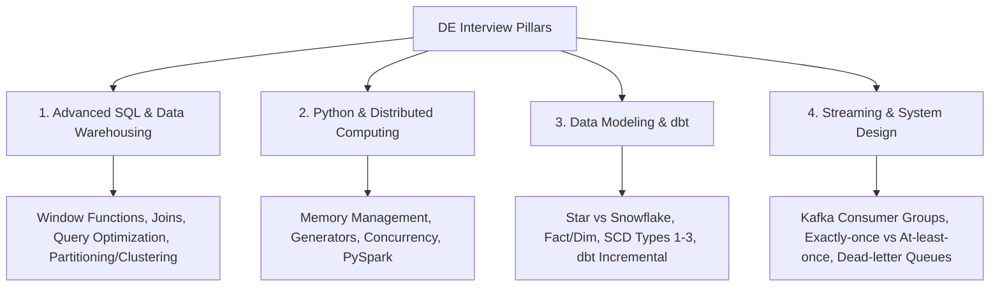

# Data Engineer Job Switch Preparation Playbook
**Candidate:** Aditya Yelegaon (2 YOE Data Engineer)  
**Target Roles:** Data Engineer / Cloud Data Engineer (2–4 YOE band)

---

## 1. Resume Critique & "Danger Zones" to Address

> [!WARNING]
> Interviewers in tech and product companies will quickly spot a few common patterns in your current resume. You must proactively tighten these before applying.

### A. The "Manual / Analyst" Trap in Experience
* **Current Impression:** Phrases like *"in Jupyter"*, *"in CSV and Excel formats"*, and *"validated loaded data with SQL queries"* can make interviewers think you performed ad-hoc data analysis or manual QA rather than engineering robust, automated production pipelines.
* **The Fix:** Frame your work around **automation, data contracts, pipeline orchestration, CI/CD, and scale**.

| Current Bullet | Problem | Recommended Stronger Version |
| :--- | :--- | :--- |
| *Processed vehicle calibration and sensor datasets in CSV and Excel formats using Python (Pandas, NumPy) in Jupyter, producing cleaned, transformed CSV outputs for downstream teams.* | Sounds like interactive notebook scripting. | **Automated ingestion and transformation pipelines using Python to clean, validate, and standardize multi-source vehicle calibration and high-frequency telemetry sensor datasets, reducing downstream processing latency.** |
| *Ran cloud workflows to load processed datasets into BigQuery, making them available for downstream access and analysis.* | "Ran cloud workflows" sounds passive, like clicking run. | **Orchestrated cloud ELT workflows to load pre-processed calibration data into partitioned BigQuery tables, establishing automated schema validation and access control for downstream analytics.** |
| *Validated loaded data with SQL queries, checking outputs against expected results...* | Sounds like manual spot-checking. | **Designed automated SQL-based data reconciliation and anomaly-detection suites to verify data integrity across landing, staging, and production layers, catching upstream sensor drift.** |

---

### B. Portfolio Projects (The "DE Zoomcamp" Pattern)
* NYC Taxi + Kafka Stock Market + OpenAQ/BigQuery/dbt are classic curriculum projects. Interviewers frequently see these exact titles.
* **How to stand out:**
  1. Do not just talk about the "happy path." Be prepared to explain:
     - How you handled **late-arriving events** and **schema evolution**.
     - How you handled **idempotency** (preventing duplicate records on consumer restarts).
     - Partitioning and clustering strategies in BigQuery and cost implications.
  2. If possible, rename or customize the context (e.g., *"Automated Geospatial Ride Ingestion Engine"* or *"Fault-Tolerant Real-Time Telemetry Pipeline"*).

---

### C. Cloud Alignment (GCP vs. Azure)
* You have **Azure certifications (AZ-900, DP-900, PL-300)**, but your primary hands-on work and projects use **Google Cloud (BigQuery, GCS, Pub/Sub)**.
* **Interview Positioning:**
  - *"I have fundamental multi-cloud awareness (Azure certified), but my core hands-on production and pipeline implementation experience is deeply rooted in GCP (BigQuery, GCS, Pub/Sub) and open-source tooling (Kafka, dbt, Docker, Postgres)."*

---

## 2. Core Technical Preparation Syllabus



---

### Pillar 1: Advanced SQL & Data Warehousing (BigQuery)

Expect live coding in LeetCode/HackerRank or shared docs. You must be able to write window functions and complex aggregations cleanly without hesitation.

#### Must-Master Topics:
1. **Window Functions:**
   - `ROW_NUMBER()`, `RANK()`, `DENSE_RANK()` (e.g., finding the top-N records per category, de-duplication).
   - `LEAD()` and `LAG()` (e.g., sessionization, calculating differences between consecutive sensor pings).
   - Rolling/cumulative aggregations (`SUM(...) OVER (PARTITION BY ... ORDER BY ... ROWS BETWEEN ...)`).
2. **BigQuery Internals & Performance:**
   - **Partitioning vs. Clustering:** When to partition by ingestion time vs. event date; clustering up to 4 columns for query pruning.
   - **Slot Contention & Pricing:** Difference between On-Demand and Editions (Slots); avoiding `SELECT *`; filtering early (`WHERE` before `JOIN`).
   - **Nested & Repeated Fields:** Working with `RECORD` / `STRUCT` and `ARRAY` types using `UNNEST()` (crucial for modern BigQuery interviews).

---

### Pillar 2: Python for Data Engineering

Interviewers test whether you write production-grade, memory-safe code or just notebook scripts.

#### Must-Master Concepts:
1. **Memory-Safe Ingestion:**
   - Never load a 10 GB file into memory with `pd.read_csv()` all at once.
   - Using `chunksize` in Pandas, Python generators (`yield`), and batch commits with SQLAlchemy/Psycopg2.
2. **Object-Oriented Design & Clean Code:**
   - Base connector classes (e.g., `BaseIngestor`, `GCSIngestor`, `PostgresLoader`).
   - Robust error handling: Retries with exponential backoff (e.g., using `tenacity` or `urllib3`).
3. **Apache Spark / PySpark:**
   - Architecture: Driver, Executors, Cluster Manager.
   - Transformations (Lazy, Narrow vs. Wide) vs. Actions (`count()`, `collect()`, `write`).
   - The Shuffle mechanism and why wide transformations (`groupBy`, `join`) cause performance bottlenecks.
   - Broadcast Joins (`broadcast(df_small)`) to eliminate shuffles when joining large and small tables.

---

### Pillar 3: Data Modeling & dbt

#### Must-Master Concepts:
1. **Dimensional Modeling:**
   - Fact Tables (Transactional, Periodic Snapshot, Accumulating Snapshot).
   - Dimension Tables: Conformed dimensions, Degenerate dimensions.
   - **Slowly Changing Dimensions (SCD):**
     - SCD Type 1: Overwrite.
     - SCD Type 2: Add row with validity timestamps (`valid_from`, `valid_to`, `is_current`).
     - SCD Type 3: Add new column for previous value.
2. **dbt (data build tool):**
   - Materializations: `table`, `view`, `ephemeral`, `incremental`.
   - **Incremental Models:** How `is_incremental()` works, `unique_key`, and handling late-arriving records.
   - Testing: Generic tests (`unique`, `not_null`, `accepted_values`, `relationships`) vs. Singular SQL tests.
   - Snapshots for implementing SCD Type 2 automatically.

---

### Pillar 4: Event-Driven Streaming & Architecture (Kafka + GCP)

#### Must-Master Concepts:
1. **Apache Kafka Fundamentals:**
   - Topic, Partition, Broker, Replication Factor.
   - **Consumer Groups & Offsets:** What happens during a rebalance? How does consumer lag occur and how is it monitored?
   - **Delivery Guarantees:** At-most-once vs. At-least-once vs. Exactly-once (idempotent producer + transactions).
   - What happens when a downstream database crashes? (Dead Letter Queues / retries).
2. **GCP Data Ecosystem:**
   - Cloud Storage (GCS) landing patterns (Bronze / Raw -> Silver / Cleaned -> Gold / Modeled).
   - Pub/Sub vs. Kafka comparison (managed serverless vs. partition-key ordered distributed log).

---

## 3. Project Storytelling Framework (STAR Method)

When the interviewer says: *"Walk me through your work at Stellantis / Capgemini"*:

```
1. Situation (15%):
   "At Capgemini, I worked on the Stellantis automotive data platform. We dealt with 
   high-volume vehicle calibration and sensor telemetry collected across test vehicles."

2. Task (15%):
   "The challenge was that sensor data came in heterogeneous batches with frequent nulls, 
   timestamp jitters, and inconsistent schema definitions. Downstream analytics and vehicle 
   validation engineers needed trusted, reconciled tables in Google BigQuery."

3. Action (50%):
   "I built modular Python ETL pipelines to ingest and standardize this data. I enforced strict 
   data contracts and validation checks (checking sensor ranges and null thresholds) before 
   landing files into GCS. 
   In BigQuery, I structured datasets into partition-pruned tables by ingestion date and clustered 
   by vehicle/sensor IDs to optimize query costs. I also authored automated SQL reconciliation scripts 
   to cross-verify raw counts against loaded rows and catch sensor drift early."

4. Result (20%):
   "This automated what was previously a manual, error-prone data-cleaning cycle, reduced data 
   reconciliation turnaround by ~40%, and eliminated downstream dashboard failures caused by schema drift."
```

---

## 4. 4-Week Sprint Plan for Job Switch

| Week | Focus Area | Daily Target |
| :--- | :--- | :--- |
| **Week 1** | **SQL Mastery & Data Warehousing** | • 5 Medium SQL problems daily (Window functions, joins).<br>• Revise BigQuery partitioning/clustering & Kimball modeling (SCD 1 & 2). |
| **Week 2** | **Python & PySpark Fundamentals** | • Python data structures, generators, OOP pipeline code.<br>• Spark architecture: shuffles, narrow/wide transformations, broadcast joins. |
| **Week 3** | **dbt & Streaming (Kafka / PubSub)** | • Deep dive into dbt incremental strategies & tests.<br>• Kafka internals: consumer groups, lag, offset commits, idempotency. |
| **Week 4** | **System Design & Mock Interviews** | • Practice designing: Batch pipeline (API -> GCS -> BigQuery -> dbt) & Streaming pipeline (Kafka -> Consumer -> DB).<br>• Rehearse STAR pitch for Capgemini & personal projects. |
