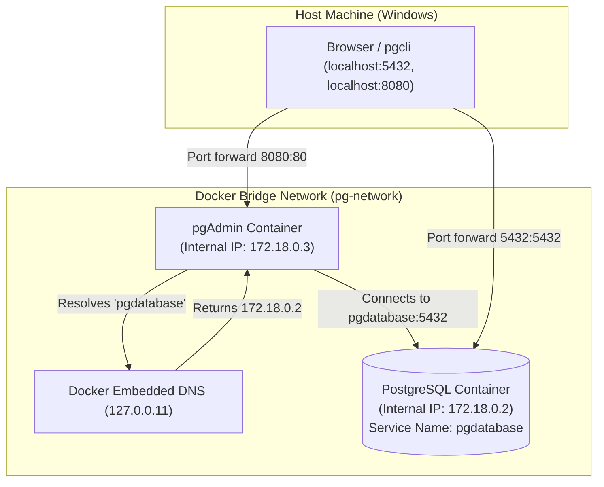

# Module 1 DE Interview Q&A & Technical Question Bank

**Topic Focus:** Docker, Container Networking, PostgreSQL Internals, & Memory-Safe Data Ingestion  
**Target Roles:** Data Engineer / Senior Data Engineer (2–4 YOE)  
**Alignment:** DE Zoomcamp Module 1 & Enterprise Production Engineering

---

## Part 1: Docker & Container Infrastructure

### Q1: Why do Data Engineers use Docker instead of just Python virtual environments (`venv` / `conda`)?
* **Junior Answer:** "Docker lets you package dependencies so code works on any machine."
* **Senior / Strong Answer:**
  > *"Python virtual environments only isolate Python packages. They do not isolate system-level C-libraries (e.g., `libpq-dev` for Postgres, `geos`/`gdal` for geospatial, or `librdkafka`), underlying OS binaries, Python runtime versions, or background services.*  
  > *Docker provides process-level virtualization using Linux namespaces and cgroups. In data pipelines, this guarantees 100% environment parity between local development, CI/CD, and production orchestrators (Airflow/K8s/ECS). It also prevents dependency conflicts between microservices and allows us to package dependencies and pipeline code into immutable, deployable artifacts."*

---

### Q2: How does container-to-container networking work in Docker Compose? Why did `localhost:5432` fail when connecting pgAdmin to Postgres?
* **The Concept to Explain:**
  > *"Each Docker container operates in its own network namespace with its own `localhost` loopback interface (`127.0.0.1`). Inside the `pgadmin` container, `localhost:5432` means port 5432 on the `pgadmin` container itself—where no database is running.*  
  > *When we declare a user-defined bridge network (like `pg-network`) in `docker-compose.yaml`, Docker runs an **embedded DNS server** at `127.0.0.11`. Docker automatically maps each container's service name (`pgdatabase`) to its dynamic internal IP address on that bridge. Therefore, `pgadmin` must address Postgres by its service name: `pgdatabase:5432`."*



---

### Q3: What is the difference between a Bind Mount and a Named Volume in Docker? When do you choose which?
* **Comparison Table:**

| Feature | Bind Mount (`./pg_data:/var/...`) | Named Volume (`volume_name:/var/...`) |
| :--- | :--- | :--- |
| **Location** | Exact user-specified path on the host filesystem. | Managed internally by Docker daemon (e.g. `/var/lib/docker/volumes/`). |
| **Host Access** | Directly visible and editable in your project folder. | Isolated from host OS browsing. |
| **Performance** | Can be slower on macOS/Windows due to OS virtualization file syncing. | High I/O throughput (native Linux filesystem speeds). |
| **Best For** | Development environments, live source code reload, local DB debugging. | Production databases, high-throughput storage, CI/CD pipelines. |

> [!TIP]
> **Interview Pro-Tip:** Mention that on Windows/macOS, running heavy I/O workloads over bind mounts can encounter file-sharing overhead across the WSL2/Hyper-V virtualization layer, whereas named volumes run natively inside the VM disk for maximum performance.

---

### Q4: In Docker Compose, does `depends_on: [pgdatabase]` guarantee that PostgreSQL is ready to accept queries?
* **The Trap:** Most junior engineers say "Yes, pgdatabase starts first."
* **The Reality & Senior Answer:**
  > *"No. `depends_on` only waits for the `pgdatabase` container to reach the **RUNNING state** (process started); it does **not** wait for the database engine inside to finish its internal initialization, replay WAL logs, and start listening on TCP port 5432.*  
  > *In production pipelines, if a dependent service starts executing immediately, it will throw a `ConnectionRefusedError`. To solve this, we implement a **healthcheck** in Docker Compose or use a retry loop / `pg_isready` wrapper in our entrypoint script."*

```yaml
# Production Healthcheck Example:
pgdatabase:
  image: postgres:16
  healthcheck:
    test: ["CMD-SHELL", "pg_isready -U root -d ny_taxi"]
    interval: 5s
    timeout: 5s
    retries: 5

pgadmin:
  depends_on:
    pgdatabase:
      condition: service_healthy
```

---

## Part 2: Relational Databases & PostgreSQL Internals

### Q5: When should a Data Engineer choose PostgreSQL vs. an OLAP Data Warehouse like BigQuery or Snowflake?
* **Senior Breakdown:**
  * **PostgreSQL (OLTP - Row-Oriented):**
    * Optimized for frequent, low-latency, single-row or small-batch transactions (`INSERT`, `UPDATE`, `DELETE`).
    * Stores full row tuples sequentially on 8KB disk pages.
    * Best as an application database, operational datastore, or metadata catalog.
  * **BigQuery / Snowflake (OLAP - Columnar):**
    * Optimized for analytical aggregations (`SUM`, `AVG`, `GROUP BY`) over tens of millions to billions of rows.
    * Stores each column independently (e.g., Capacitor in BigQuery, Parquet).
    * Scans only the specific columns requested in the query, cutting I/O and query costs drastically.

> [!IMPORTANT]
> **The Elevator Pitch:** *"Postgres is designed for high-concurrency transactional writes and point lookups; BigQuery is designed for distributed columnar aggregation over terabytes of analytical data."*

---

### Q6: How do B-Tree Indexes work in PostgreSQL, and why can having too many indexes hurt pipeline performance?
* **Answer:**
  * A B-Tree (Balanced Tree) index organizes indexed column values in a sorted multi-level tree structure, providing $O(\log N)$ search complexity instead of an $O(N)$ sequential table scan.
* **Why Indexes Hurt Batch Ingestion:**
  * Every single `INSERT` or batch load requires PostgreSQL to update not just the heap table, but **every associated B-Tree index on that table**.
  * Rebalancing B-Tree nodes and writing index pages creates severe I/O amplification.
  * **Production Optimization:** For massive initial batch loads (e.g., tens of millions of historical taxi records), drop indexes and foreign keys before loading, bulk insert the data, and recreate the indexes afterward. Rebuilding indexes in one pass is significantly faster than incremental updates.

---

### Q7: What does `EXPLAIN ANALYZE` do, and what are the key scan types to look for?
* **Answer:**
  * `EXPLAIN` shows the cost estimate generated by the Postgres Query Planner.
  * `EXPLAIN ANALYZE` actually executes the query and prints real elapsed times, row counts, and buffer hits.
* **Scan Types to Know:**
  1. **Seq Scan (Sequential Scan):** Scans every page in the table. Normal for small tables or when reading >20% of rows; terrible for selective queries on large tables.
  2. **Index Scan:** Traverses the B-Tree index to locate row pointers (`TID`), then fetches the actual table pages from heap.
  3. **Index Only Scan:** The query's requested columns are all present in the index itself; Postgres never has to touch the table heap (fastest).
  4. **Bitmap Index Scan:** Combines multiple indexes using bitwise AND/OR operations before reading data pages.

---

## Part 3: Python Data Ingestion & Memory Management

### Q8: What happens if you execute `pd.read_csv("huge_50gb_file.csv")` on a machine with 16 GB of RAM? How do you solve it?
* **Answer:**
  * The OS will attempt to allocate memory until RAM and swap space are exhausted. The Linux kernel's **OOM Killer (Out Of Memory Killer)** will trigger `SIGKILL` (exit code `137`), abruptly terminating the Python process.
  * Furthermore, Pandas data structures typically consume 2x to 5x the raw file size in memory due to object wrappers, boxed types, and string pointers.

* **The Production Solution (Chunking & Streaming):**
  1. Use Pandas `chunksize` iterator:
     ```python
     for chunk in pd.read_csv("huge_file.csv", chunksize=100_000):
         chunk.to_sql(name="taxi_trips", con=engine, if_exists="append", index=False)
     ```
  2. For Parquet files, use **PyArrow** batch streaming (`iter_batches`):
     ```python
     import pyarrow.parquet as pq

     parquet_file = pq.ParquetFile("yellow_tripdata_2026-01.parquet")
     for batch in parquet_file.iter_batches(batch_size=100_000):
         df_chunk = batch.to_pandas()
         df_chunk.to_sql(name="yellow_taxi_data", con=engine, if_exists="append", index=False)
     ```

---

### Q9: `df.to_sql()` in Pandas is notoriously slow by default. Why, and how do you make it 50x faster?
* **Why it's slow:**
  * By default, `df.to_sql()` generates individual SQL `INSERT INTO ... VALUES (...)` statements for each row, resulting in high network round-trip latency and transactional overhead.
* **How to Optimize:**
  1. **Method 1: Batch multi-row inserts (`method='multi'`):**
     * Sends blocks of rows in a single SQL statement:
       ```python
       df.to_sql(..., method='multi', chunksize=10_000)
       ```
  2. **Method 2: Native PostgreSQL `COPY` command (Fastest):**
     * Uses PostgreSQL's binary streaming `COPY FROM STDIN` protocol. This bypasses SQL parsing overhead and streams raw tabular data directly into the database engine.
     * Can achieve ingestion speeds of **100,000+ rows per second**.

---

### Q10: What is Pipeline Idempotency, and how do you achieve it in batch ingestion?
* **Definition:**
  > *"An idempotent pipeline can be executed multiple times with the exact same input data without changing the final state of the database or creating duplicate records."*
* **The Problem:**
  * If a batch script crashes midway while inserting 500,000 rows, a simple rerun will either duplicate records or fail with primary key collisions.
* **Strategies to Ensure Idempotency:**
  1. **Staging Table & Atomic Swap (Truncate & Load):**
     * Ingest batch into a temporary staging table (`yellow_taxi_staging`).
     * Run data quality validation checks on staging.
     * In an atomic transaction (`BEGIN; ... COMMIT;`), delete the date partition from the production table and insert from staging.
  2. **Upsert (`ON CONFLICT DO UPDATE` / `MERGE`):**
     * Use natural keys or hash keys to update existing records if they match or insert if new.

---

## Part 4: Real-World Scenario Interview Questions

### Scenario 1: "Your batch container dies with Exit Code 137 in production. What is your troubleshooting checklist?"
1. **Identify the root cause:**
   * Exit Code 137 indicates `128 + 9` = `SIGKILL`. This almost always means the container exceeded its allocated Docker/Kubernetes memory limit and was killed by the OS Out-Of-Memory (OOM) killer.
2. **Verify logs:**
   * Run `docker inspect <container_id>` to check the `OOMKilled: true` flag.
   * Check Linux kernel logs: `dmesg -T | grep -i oom`.
3. **Remediation:**
   * Reduce the batch/chunk size in Python (e.g. from 200,000 rows to 50,000 rows).
   * Explicitly call garbage collection (`gc.collect()`) or eliminate memory retention inside batch loops.
   * Adjust container memory limits (`--memory="4g"`) if the workload legitimately requires higher headroom.

---

### Scenario 2: "A Junior Engineer writes an ingestion script that commits every single row individually to Postgres. What performance issues will this cause?"
* **Answer:**
  * Every single commit incurs a synchronous disk write to the **Write-Ahead Log (WAL)** via `fsync()` to satisfy the ACID Durability guarantee.
  * Incurring 1 million individual `fsync()` calls turns an ingestion job that should take 15 seconds into a multi-hour crawl.
  * **Fix:** Group operations into transactions of 10,000 to 50,000 rows, or use bulk `COPY`.

---

## Part 5: Rapid-Fire Screening Cheat Sheet

| Question | 1-Sentence High-Impact Answer |
| :--- | :--- |
| **What is Docker bridge networking?** | A private internal virtual switch that isolates containers while providing automatic DNS resolution by service name. |
| **Why pin Docker image versions?** | To ensure pipeline reproducibility and prevent unexpected production breakage caused by upstream base image updates. |
| **What is Write-Ahead Logging (WAL) in Postgres?** | An append-only log on disk where changes are recorded before applying to data pages, ensuring crash recovery and durability. |
| **What is the difference between `EXPLAIN` and `EXPLAIN ANALYZE`?** | `EXPLAIN` predicts the query plan based on optimizer statistics, while `EXPLAIN ANALYZE` actually executes the query to return real runtime metrics. |
| **Why use generators (`yield`) in Python data pipelines?** | To evaluate data lazily on demand, keeping memory consumption constant ($O(1)$) regardless of the total dataset size. |
