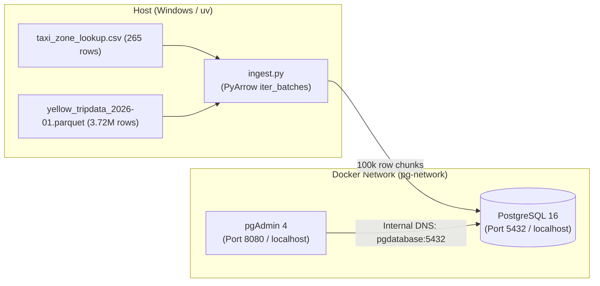

# Session Checkpoint: Module 1 DE Zoomcamp

## Latest Checkpoint — October 22, 2026

The first end-to-end NYC Yellow Taxi analytics project is complete enough to move on after a small Power BI axis adjustment. The current report is [`Final Dashboard NYC Taxi Data.pbix`](../Final%20Dashboard%20NYC%20Taxi%20Data.pbix); [`Dashboard.pbix`](../Dashboard.pbix) is an earlier report version. The PostgreSQL Gold view reconciles to 3,475,080 January Silver trips across 463,623 groups. SQL analysis is in [`../sql/analyze_gold_yellow_taxi_2025_01.sql`](../sql/analyze_gold_yellow_taxi_2025_01.sql), and the dashboard's model, DAX, and validation notes are in [`power_bi_dashboard_model.md`](power_bi_dashboard_model.md).

### Current Power BI Model

- The fact table is the Gold daily aggregate. Its grain is pickup date, pickup borough/zone, dropoff borough/zone, and payment type; `trip_count` is additive.
- `DimDate`, `DimPickupLocation`, and `DimDropoffLocation` filter the fact with one-to-many, single-direction relationships. The location dimensions are built from distinct Gold borough/zone pairs and connect through composite pair keys.
- Do not join this Gold aggregate to `zones` on borough and zone to recover `LocationID`. That label pair is not unique: Manhattan's Governor's Island/Ellis Island/Liberty Island label maps to IDs 103, 104, and 105; Queens' Corona maps to IDs 56 and 57. Those merges inflated a Power BI daily total. The corrected Jan 1 Power BI total is 90,186, matching PostgreSQL.
- A separate PostgreSQL trip-level model is defined in [`../sql/star_schema_yellow_taxi_2025_01.sql`](../sql/star_schema_yellow_taxi_2025_01.sql). It retains source location IDs and is appropriate when ID-level location detail is needed.

### Resume / Final Polish

1. Open `Final Dashboard NYC Taxi Data.pbix`.
2. On both daily trend charts, set the X-axis to the raw `DimDate[Date]` field rather than a Date hierarchy level. The last screenshot showed the axis grouped at Year (`2025`).
3. Clear slicers and selected chart points to review the full January dashboard. The day and weekday slicers were intentionally active in the last validation screenshot; selecting Wednesday and day 1 makes both KPI cards show 90,186 for Jan 1.
4. Save the report. Then move on to the next project, adding orchestration and automated quality checks.

The review-flag percentage counts each trip once if any provisional flag applies. It is a triage signal, not a count of confirmed invalid trips. The Vendor 2 Flex Fare pattern remains an unresolved source-data finding; preserve and flag those rows rather than deleting them.

---

**Date:** October 16, 2026  
**Status:** Milestone 3 & 4 Completed Successfully

> **Follow-up:** This checkpoint captures the October 16 session. The later data-quality work and the current database table state are recorded in [`data_quality_workflow.md`](data_quality_workflow.md).

---

## 1. Quick Revision Summary (What We Built Tonight)



### Key Engineering Concepts Mastered:
1. **Multi-Container Orchestration (`docker-compose.yaml`):**
   * Configured PostgreSQL 16 and pgAdmin 4.
   * Bound `./pg_data` to `/var/lib/postgresql/data` for persistent database storage on your drive.
   * User-defined bridge network `pg-network` allowing containers to discover each other via internal DNS (`pgdatabase:5432`).
2. **Memory-Safe Batch Ingestion (`ingest.py`):**
   * Avoided the $O(N)$ RAM trap by streaming chunks of 100,000 rows with `pyarrow.parquet.ParquetFile.iter_batches()`.
   * Fully parameterized with `argparse` (`--user`, `--password`, `--host`, `--port`, `--db`, `--table_name`, `--url`, `--chunksize`).
3. **Current Ingested State in PostgreSQL (`ny_taxi`):**
   * Table `zones`: **265 rows**
   * Table `yellow_taxi_trips`: **3,724,889 rows** (~3.72 Million records)
4. **Interview Preparation Guide:**
   * Created [`docs/module1_interview_qa.md`](file:///c:/Users/yeleg/VS/postgres_docker/docs/module1_interview_qa.md) covering Docker internals, OOM killer (Exit 137), B-Tree indexes, and WAL logging.

---

## 2. Agenda for Tomorrow

1. **2-Minute Warmup Revision:**
   * Rapid review of Docker bridge networking, bind mounts vs volumes, and batch chunking.
2. **Importing ALL NYC Taxi Data:**
   * How the NYC TLC URL pattern works:  
     `https://d37ci6vzurychx.cloudfront.net/trip-data/yellow_tripdata_{YEAR}-{MONTH}.parquet`
   * Automating multi-month ingestion via a loop script or CLI range without downloading giant files manually.
3. **Dockerizing the Ingestion Engine (`Dockerfile`):**
   * Package `ingest.py` into a lightweight container.
   * Run the ingestion pipeline *inside* the Docker network directly targeting `pgdatabase:5432`.
4. **Analytical SQL Queries (Zoomcamp Homework & Analytics):**
   * Validating pickup zones, largest tips, and longest trip distances using SQL.

---

## 3. End-of-Day Shutdown Commands

To cleanly shut down your database containers tonight:
```bash
docker compose down
```
*(Your data in `./pg_data` is saved and will immediately reload tomorrow when you run `docker compose up -d`!)*
