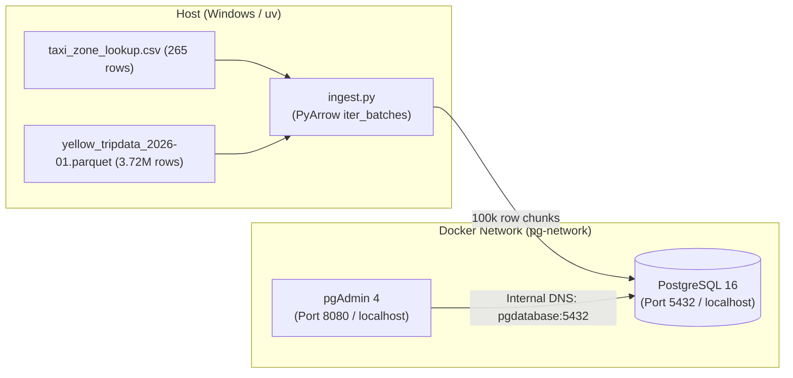

# Session Checkpoint: Module 1 DE Zoomcamp

## Latest Checkpoint — October 19, 2026

The current working Power BI report is [`Dashboard.pbix`](../Dashboard.pbix) in the repository root. The January 2025 Gold daily-demand view has been built and reconciled to the Silver table: 3,475,080 trips across 463,623 groups. Gold analysis queries are saved in [`sql/analyze_gold_yellow_taxi_2025_01.sql`](../sql/analyze_gold_yellow_taxi_2025_01.sql), and dashboard setup guidance is in [`dashboard_first_chart.md`](dashboard_first_chart.md).

### Resume Here

1. Start PostgreSQL with `docker compose up -d` if the containers were stopped, then open `Dashboard.pbix`.
2. Finish the visual field assignments:
   - Daily trend: use the `pickup_date` column (not **Date hierarchy > Day**) on X; `total_trips` on Y.
   - Manhattan zone ranking: `total_trips` as the only bar value; `pct_of_manhattan_pickups` in Tooltips.
   - Weekday/borough chart: `average_daily_trips` as the value; `days_in_january` in Tooltips; use the borough slicer to inspect smaller boroughs.
   - Quality trend: `pct_trips_with_review_flags` as the only Y value; trip counts in Tooltips.
   - Remove the unused blank visual. The two KPI cards should show about 3.48M monthly trips and 112.10K average daily trips.
3. Save the report and review the final layout. Query 8's result table has not yet been shared for a separate daily quality-pattern interpretation.

The next optional dashboard extension is a chart of the daily review-flag percentage. The measure counts each trip once if any provisional review condition applies; it is a review signal, not a count of confirmed invalid trips.

---

**Date:** October 16, 2026  
**Status:** Milestone 3 & 4 Completed Successfully

> **Follow-up:** This checkpoint captures the October 16 session. The later data-quality work and the current database table state are recorded in [`data_quality_workflow.md`](data_quality_workflow.md).

---

## 1. Quick Revision Summary (What We Built Tonight)



### Key Engineering Concepts Mastered:
1. **Multi-Container Orchestration (`docker-compose.yaml`):**
   * Configured PostgreSQL 16 and pgAdmin 4.
   * Bound `./pg_data` to `/var/lib/postgresql/data` for persistent database storage on your drive.
   * User-defined bridge network `pg-network` allowing containers to discover each other via internal DNS (`pgdatabase:5432`).
2. **Memory-Safe Batch Ingestion (`ingest.py`):**
   * Avoided the $O(N)$ RAM trap by streaming chunks of 100,000 rows with `pyarrow.parquet.ParquetFile.iter_batches()`.
   * Fully parameterized with `argparse` (`--user`, `--password`, `--host`, `--port`, `--db`, `--table_name`, `--url`, `--chunksize`).
3. **Current Ingested State in PostgreSQL (`ny_taxi`):**
   * Table `zones`: **265 rows**
   * Table `yellow_taxi_trips`: **3,724,889 rows** (~3.72 Million records)
4. **Interview Preparation Guide:**
   * Created [`docs/module1_interview_qa.md`](file:///c:/Users/yeleg/VS/postgres_docker/docs/module1_interview_qa.md) covering Docker internals, OOM killer (Exit 137), B-Tree indexes, and WAL logging.

---

## 2. Agenda for Tomorrow

1. **2-Minute Warmup Revision:**
   * Rapid review of Docker bridge networking, bind mounts vs volumes, and batch chunking.
2. **Importing ALL NYC Taxi Data:**
   * How the NYC TLC URL pattern works:  
     `https://d37ci6vzurychx.cloudfront.net/trip-data/yellow_tripdata_{YEAR}-{MONTH}.parquet`
   * Automating multi-month ingestion via a loop script or CLI range without downloading giant files manually.
3. **Dockerizing the Ingestion Engine (`Dockerfile`):**
   * Package `ingest.py` into a lightweight container.
   * Run the ingestion pipeline *inside* the Docker network directly targeting `pgdatabase:5432`.
4. **Analytical SQL Queries (Zoomcamp Homework & Analytics):**
   * Validating pickup zones, largest tips, and longest trip distances using SQL.

---

## 3. End-of-Day Shutdown Commands

To cleanly shut down your database containers tonight:
```bash
docker compose down
```
*(Your data in `./pg_data` is saved and will immediately reload tomorrow when you run `docker compose up -d`!)*
